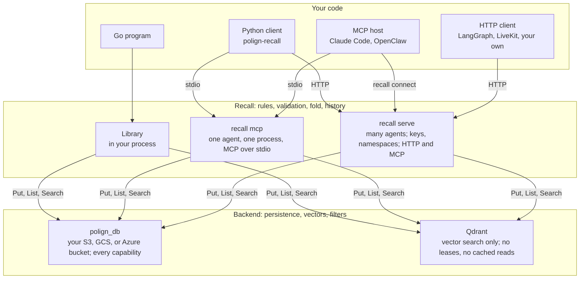
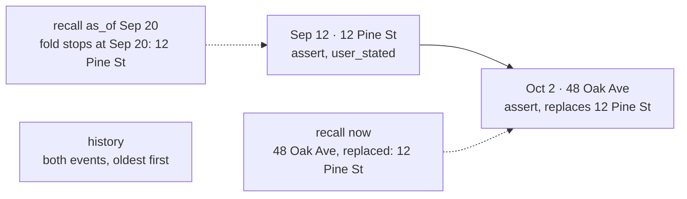
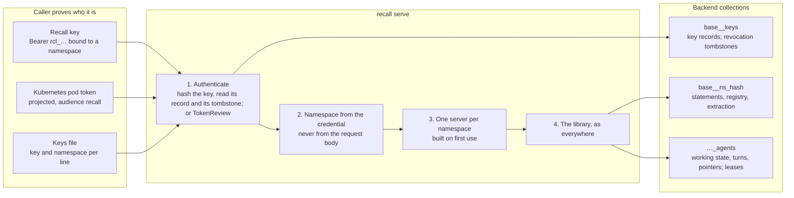

# Recall architecture

How Recall is built, for someone reading or changing the code. It covers the
record Recall stores, the fold that turns records into answers, the registry
that holds the correction rules, search, cached reads, the `recall serve`
front door, agent resume, audit bundles, and what a storage backend has to
provide. It describes recall 0.18. Paths are relative to the repository root.

For what each part is for, read the [README](../README.md) first. For the
contract clients are written against, read [memory-api-v1.md](memory-api-v1.md).

## The shape of the system

Recall is a library with two optional processes around it. The library holds
every rule: what a statement must look like, how corrections work, how history
folds into an answer. It stores nothing itself. A backend holds the records,
and the backend is a vector store you run.

One deployment uses one backend. The three ways to run Recall share one code
path; they differ in who they answer and how.

| Where | Code | What it adds |
| --- | --- | --- |
| Library | `recall.go`, `internal/engine/` | Everything below. No dependencies outside the Go standard library. The root package is type aliases and forwarding functions; behavior lives in the engine. |
| `recall mcp` | `cmd/recall/mcp*.go`, `memory.go` | A Model Context Protocol server over stdio for one agent against one collection. The Python client (`python/polign_recall/client.py`) starts it as a subprocess and speaks JSON-RPC to it. |
| `recall serve` | `cmd/recall/serve.go`, `keys.go`, `kubeauth.go` | An HTTP server for many agents: authentication, one collection per namespace, MCP over streamable HTTP, and plain HTTP verbs. `recall connect` bridges a stdio host to it. |

## A memory is an event

Recall writes one kind of record: an **event** (`internal/engine/event.go`).
An event says that a subject stands in a predicate relation to a value, and
when that was observed. It is never updated in place. A correction is a new
event, and forgetting is a new event with the retraction flag set. The log of
events for one subject and predicate is the complete record of what was ever
said about that pair.

| Field | What it holds |
| --- | --- |
| `subject`, `predicate`, `value` | The statement. The subject is lowercased; the value is stored with the type the registry declares (string, number, boolean; enums, dates and references are strings in a canonical form, see `predicate.go`). |
| `observed_at` | When the statement was made. The fold orders by this, not by when the backend accepted the write. Stored twice (`codec.go`): a fixed-width RFC 3339 string that sorts lexically, and milliseconds for numeric range filters. |
| `retraction` | True for a forget. Withdraws one value, or every value of the pair when it names none. |
| `replaces`, `replaced_by` | Which earlier beliefs this statement made untrue, under any predicate, and which later statement withdrew this one. Both recorded on the events; the fold derives answers from them. |
| `evidence`, `evidence_id` | The exact excerpt a statement was drawn from, and the id of the note holding the whole text. `explain` reads these back. |
| `kind`, `source`, `confidence` | Fact or preference; `user_stated`, `agent_inferred` or `tool_result`; 0 to 1. |
| `id` | A hash of the statement and its instant (`eventID` in `codec.go`). Content alone would make a re-assertion overwrite the retraction between the two. |

In the backend an event is one vector with this metadata attached. The vector
is the embedding of the statement rendered as a sentence (`Event.Text`, "user
prefers editor neovim"), so semantic search and exact filtered reads see the
same statements. The metadata also carries that sentence, with the evidence
appended, in one text field for a backend that indexes text.

Three families of record share a memory collection and are read by the same
code:

- **Statements**, described above.
- **Registry changes**, filed under subject `recall:registry` (`schema.go`).
  When a write defines a predicate under an open vocabulary, or an operator
  redefines, merges or splits one, the change is an event in the same log. A
  reader folds the registry's history first, then reads statements through
  the definitions that held at the instant it is asking about.
- **Extraction records**, filed under `recall:extraction` (`extract.go`).
  When a model works out the statements in a passage, its proposals are
  recorded beside the passage. Remembering the same text again replays them
  instead of asking the model again, so a retried write files exactly as the
  first attempt did.

Agent resume records and `recall serve` keys live in collections of their
own, because every record in a memory collection must decode as an event or
an export fails.

## Reading folds the log

Beliefs are never stored. They are derived, every time, by `Fold` in
`event.go`: given the events of a pair, the predicate's cardinality, and an
instant, return the values believed at that instant. "What is believed now"
and "what was believed on Tuesday" are the same call with a different
ceiling.

The fold walks the pair's events in observation order, stopping at the
instant asked about, and applies each one:

- An **assertion** replaces what is held when the predicate was single-valued
  at that instant, and accumulates when it was multi-valued. Cardinality is
  read as of the event (`foldWith`), so a question about an instant before a
  registry change is answered the way it was at the time.
- A **retraction** withdraws the matching value, or every value when it names
  none.
- A statement's **`replaces`** withdraws the earlier beliefs it names, under
  any predicate.
- An assertion under a predicate that **excludes** this one (`dislikes`
  excludes `likes`) withdraws the same value here, exactly like a targeted
  retraction (`foldOpposed`). The excluding predicate's events are folded
  alongside only to know what it held at each instant. Exclusions are resolved
  in the fold, not at write time, so an old log is covered by a rule added
  later. A predicate marked **historical** is never withdrawn by any of this.
- Two events sharing an instant are ordered the same way on every node and
  every replay, and a retraction never sorts before the assertion it
  withdraws.

Because the fold is a pure function of the events, a client crash between two
writes cannot produce a state the fold reads wrongly. The design this replaced
wrote a new record and then rewrote each superseded one; a crash in the middle
left two live values for a single-valued predicate. Here there is nothing to
rewrite.

### The write path

`Store.remember` in `store.go` is a read followed by at most one append, plus
a retraction per correction it carries:

1. **Validate.** Normalize the subject; the predicate must be registered (or
   definable, under an open vocabulary); the value must match the predicate's
   type; confidence and source must be in range. Nothing reaches the backend
   until this passes.
2. **Read the pair's complete history** (`foldHistory`) and fold it at the
   statement's instant. A history that would exceed `MaxHistoryEvents`
   (10,000) is refused rather than truncated.
3. **Return early if the value already holds.** Restating a belief is not new
   information, so no event is written. Idempotence lives here, not in the id.
4. **Resolve the corrections** (`resolveReplaces`). Each belief named in
   `replaces` is checked at the same instant. One that is not held, was stated
   later, is a note, or is historical is reported back as *unreplaced* rather
   than failing the write.
5. **Append one event**, then one retraction per correction (`withdraw`),
   each naming the event that caused it. If the process dies between the two,
   the next `remember` of the same statement finds the event present and the
   retractions missing, and completes them.

The write's instant is the writer's clock, nudged by a nanosecond past any
event that already holds it (`disambiguateInstant`), so two writes never
share an instant. A deliberately backdated statement stays backdated. A
forget, by contrast, is placed after everything already in the log
(`writeInstant`), because a withdrawal that sorted before a peer's later
assertion would report success having withdrawn nothing.

The write returns what it displaced, derived from the fold, and a short list
of *related* beliefs (`related.go`): current values about the same subject
under other predicates that may contradict the new one. Nothing in Recall
acts on that list; it is shown so the agent, or the person, can confirm a
correction the rules did not cover.

### The read path

- **An exact read** names a subject and predicate. Recall lists every event
  of that pair (`completeEvents`, with one row more than the limit so a
  truncated listing is detected and refused) and folds them at the instant
  asked.
- **A search** carries text. `candidatePairs` searches the backend for
  events whose sentence matches, groups the hits by pair, then `recallRanked`
  folds each candidate pair exactly as above and ranks the resulting beliefs
  by the rank of the pair's best hit. A superseded value that ranks top of the
  search cannot come back as a live belief: the hit says which pair the
  question is about, and the fold says what that pair holds now. Candidates
  are read four times wider than the requested limit, because a pair can fold
  to nothing.
- **A broad exact read** (subject or predicate alone, no text) goes through
  `discovery.go`, which keeps discovering past withdrawn or filtered pairs.

Every typed belief in an answer carries `replaced`, the values it displaced,
and `elsewhere` (`elsewhere.go`), the same value held about the same subject
under other predicates at that instant. The second is the read-time safety
net for a correction nobody linked. It is a bounded number of exact listings
per answer, and nothing is decided by it.

## Search without a model

`LexicalEmbedder` (`defaults.go`) hashes the words of a sentence into a
signed 256-dimensional vector. It needs no model, key or network, and it
retrieves overlapping words, not synonyms. Its space is versioned
(`recall-lexical-v1-256`) and the default collection name carries that
version, so a collection never mixes it with model embeddings.

`searchEvents` runs a vector search and, when the backend implements
`TextSearcher`, a BM25 keyword search over the text field, and fuses the two
(`fuseHits`). With the lexical embedder the keyword ranking leads and the
vector hits it lacks follow, since those are mostly events written after the
text index last caught up. With a model embedder the rankings are merged by
reciprocal rank fusion. On a backend without text search, the vector ranking
stands alone.

A time phrase in the question ("two weeks ago", "last Saturday", "in March")
is read as a hint (`when.go`): the span it names is searched first, then
everything. The hint reorders candidates and never drops any.

## Cached reads

Reading a pair means listing its history and folding it. For a backend that
can say whether a collection changed, `materialized.go` keeps a bounded,
process-local view of folded pairs and skips the listing when nothing did.
[materialization.md](materialization.md) has the full contract. In short:

- polign_db exposes a **watermark** per collection, an opaque token that
  changes on any mutation. A cached pair is served while the watermark it was
  folded under is unchanged and the entry is younger than the TTL. A changed
  watermark triggers a full validated read and a second check. A change
  during that read, which any write to the collection causes, is retried
  briefly and then served as an uncached fold rather than published as a
  mixed view.
- The view holds at most 1,024 pairs, invalidates its own pair on every write
  so a client reads its own writes even when the watermark lags, and is
  rebuilt from the log on restart. The durable log remains the authority.
- Every problem reading the watermark degrades to the uncached fold. A
  backend without watermarks serves every read uncached.

## The registry

The registry (`predicate.go`, `schema.go`) is the set of predicates a store
accepts, and for each one its cardinality, value type, the predicates it
excludes, whether it is historical, and any former names. It is the only
place a correction rule lives. Starter registries are in `registries/`.

- **Closed.** A write naming an unregistered predicate is refused, with the
  registered names and the advice to file the statement as a `note`. This
  stops an agent inventing near-duplicates that split one fact across two
  names that never meet.
- **Open** (`Config.Open`). A write may name any predicate, and its first
  use defines it as an event in the registry log. A new name whose embedding
  is within `MatchThreshold` of an existing one, with the same stored type,
  is filed under the existing predicate instead; `Client.Split` undoes a
  wrong match.

`note` is registered in every store: multi-valued free text that never
supersedes and ranks after typed beliefs. `Promote` files a note under a
predicate added later and keeps the note in history.

Changing a registry does not change what was remembered before. Redefine,
merge and split are events; the fold reads each statement through the
definition that held when it was made, and `explain` (`explain.go`) lists
the definitions, oldest first, that decide an answer. Two clients configured
with registries that disagree with the one recorded in the store get
`ErrRegistryMismatch` rather than a silent second opinion.

## Text in, text out

Since 0.18 the MCP tools take plain text by default (`cmd/recall/mcp_text.go`):
`remember(text)`, `recall(question)`, `forget(text)`. Underneath, the records
are the same events, so a client that starts here loses nothing when it moves
to typed statements.

1. The whole passage is written first as a note, the **episode**, so that
   every statement drawn from it can name it as evidence.
2. The model named by `-extract-model` proposes statements (`Proposal` in
   `extract.go`): subject, predicate, value, and an exact excerpt as
   evidence. Proposals are untrusted input. Each is validated against the
   registry like any write, and the batch is folded as a whole so one passage
   may carry a correction. A proposal whose predicate is not registered is
   kept as a note, not dropped.
3. The proposals are recorded beside the episode as an extraction record, so
   a retried or repeated `remember` replays them without a second model call.

The model decides how a statement is filed. It does not decide what to
forget. Replacement follows the predicate's rule as before, every filing is
recorded, and a wrong filing is corrected with one registry event. Without a
model configured, the text is kept as written and replaces nothing.

## Serving many agents

`recall serve` puts a front door (`frontDoor` in `serve.go`) in front of the
library. The server holds the backend's credentials; agents hold Recall keys.
Each namespace gets its own collection, so nothing a caller sends can reach
another namespace's records.

- **Keys** (`keys.go`) are `rcl_<id>_<secret>`. The store keeps the SHA-256
  of the whole key beside its namespace, so a leaked store yields no
  credentials. A key record is written once; renewal rewrites it with a later
  expiry; revocation writes a separate tombstone that nothing overwrites.
  Every check reads both, so last-writer-wins storage cannot resurrect a
  revoked key and no compare-and-swap is needed. Checks are cached for
  `-auth-cache-ttl` (30 s by default), so a revoked or expired key is refused
  within that time rather than at once. The key store needs a backend that
  can `Get` a record by id; otherwise `-keys-file` is the only authenticator.
- **Kubernetes workload identity** (`kubeauth.go`). A pod posts its projected
  service account token to `/v1/auth/kubernetes`. The server asks the API
  server to review it, with the same audience, and mints a short-lived key for
  `<tenant>:<pod name>`. Nothing in that identity comes from the client: the
  tenant is the service account's namespace or a label on it, and the agent
  is the pod's name, or with `-kubernetes-sandbox-claims` the SandboxClaim the
  API server says owns the pod. A pod can only get a key for itself. The
  exchange is one HTTPS call with the server's own mounted credentials; no
  client library is involved.
- **Identity envelope** (`checkIdentity`). A request may repeat the namespace,
  session or agent its credential carries, and is refused when it names
  another. A key for one agent cannot resume another.
- **Collection naming** (`namespaceCollection`). A namespace may use letters,
  digits and `_-.:`, the rule polign_db applies to key namespaces. Its
  collection is the base name, the namespace lowercased with other characters
  replaced by underscores, and a hash of the original, so "a.b" and "a_b"
  never share a collection.
- **Surfaces.** `POST /mcp` is MCP over streamable HTTP in its simplest
  conforming form: one JSON-RPC message in, one response out, no
  server-initiated stream. `POST /v1/remember`, `/v1/recall`, `/v1/forget`
  and `/v1/history` take a tool's arguments as the body. `/v1/keys` mints,
  renews and revokes keys.

A test in `cmd/recall` checks the tool definitions against
[memory-api-v1.md](memory-api-v1.md), so a tool cannot change without the
document changing.

## Resume

An agent resumes from what it wrote down (`agent.go`), not from a snapshot
of its process. It keeps four kinds of record in a collection of its own, the
memory collection's name with `_agents` appended: one **working state**
(superseded on every update, each earlier version kept), **pointers** to
where its work lives, its **turns** verbatim, and large tool **outputs**
fetched by reference.

`Resume` takes the agent's **lease**, reads those records back, adds memories
that match its focus, and renders one briefing within a token budget. A lease
is a fencing token: an epoch that only increases, granted and renewed by the
backend (`LeaseBackend`), so a holder presenting an old epoch has been
superseded and two pods resuming the same agent cannot both write. Leases
need polign_db. On Qdrant, resume works only with `Unleased: true`, which is
safe only when something else keeps one process per agent.

## Audit

`ExportAudit` (`audit.go`) produces a bundle: the complete event histories in
scope, the registry used to interpret them, an explicit as-of time, and two
version strings, `recall-event-v3` for the record fields and `recall-fold-v4`
for the fold rules. `cmd/recall-audit` reads a bundle and reproduces the
beliefs offline, with no database and no embedding model. It rejects unknown
fields, duplicate ids, invalid typed events and unsupported versions, and
checks an optional digest obtained through a separate channel.

Replay establishes what the supplied events imply under the supplied rules
at the recorded time. It cannot prove the exporter included every event, and
the format does not sign data. Export refuses to truncate: a scope larger
than `MaxExport` (10,000 events) fails rather than producing a partial
bundle. [audit.md](audit.md) has the details.

## The backend contract

A backend is a vector store with filtered listing (`Backend` in
`client.go`). Three methods are required and the rest unlock capabilities.
Backends register themselves by name at init (`RegisterBackend` in
`backends.go`), the way `database/sql` drivers do, and a program picks one by
importing it. `backendtest/` is the conformance suite a new backend has to
pass.

| Method | Used for | polign_db | Qdrant |
| --- | --- | --- | --- |
| `Put` | Append an event, a registry change, a key record, an agent record | yes | yes |
| `List` (filtered, with a total) | Complete history of a pair; exports; detecting a truncated read | yes | yes |
| `Search` (vector, filtered) | Candidate pairs for a question | yes | yes |
| `Get` by id | Evidence lookups for `explain`; the key store | yes | yes |
| `SearchText` | BM25 keyword ranking, fused with the vector ranking | yes | no |
| `Watermark` | Cached reads | yes | no |
| Leases (acquire, renew, release) | One process per agent on resume | yes | no |

Recall provides the memory rules, validation and history; the backend
provides persistence and access. Concurrent reads and writes follow the
backend's consistency guarantees. Recall adds no transaction isolation and
no replication.

## Limits, stated plainly

- A pair's history is read whole on every uncached read and write. It is
  capped at 10,000 events, and a write that would exceed the cap is refused.
- The lexical embedder finds words, not meanings. A differently phrased
  question needs a model embedder, and changing embedders means a new
  collection.
- Cached reads, keyword search and leases need polign_db.
- Text mode calls the model on every `remember` and `forget`, and the text is
  sent to its provider.
- Nothing is deleted. A forget is a withdrawal; the record stays readable
  through history and audit. Erasure is a backend operation outside Recall's
  model.
